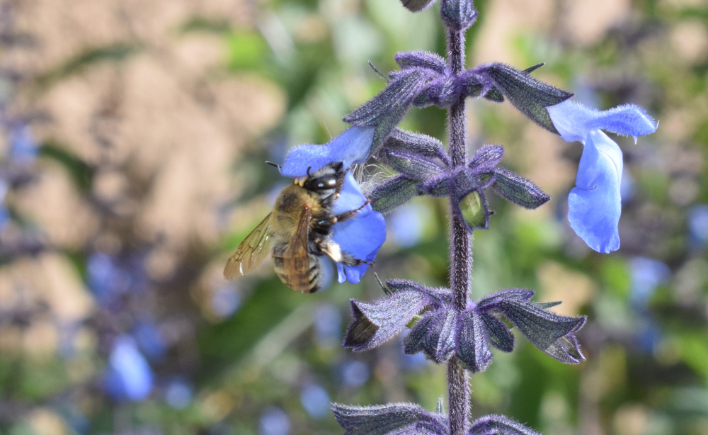

```{r setup, include=FALSE}
knitr::opts_chunk$set(echo = TRUE)
```

## Ejercicio modularidad en flores de *Salvia*

Las flores se forman a partir de 4 series de órganos: cáliz, corola,
androceo y gineceo. Con esta información pueden pensarse hipótesis de
modularidad asociadas al desarrollo. Por otra parte, estas estructuras 
pueden especializarse para desempeñar diferentes funciones, fusionándose o 
dividiéndose. A partir del conociemiento del sistema propondremos hipótesis
funcionales.   
En primer lugar construiremos esas hipótesis y compararemos cuál ajusta 
mejor a nuestros datos.



```{r echo = TRUE, eval = FALSE}
# ============================================================
# 1. CARGAR SHAPES Y PLOTEAR CONSENSO
# ============================================================

shapes <- readShapes("Práctico 5 - Modularidad/shapes_stac")
links <- read.table("Práctico 5 - Modularidad/link_salvia.txt", header = FALSE)

shapes_gm <- readland.shapes(
  shapes,
  nCurvePts = c(15, 7, 7, 16, 11, 7)
)

gpa <- gpagen(shapes_gm, print.progress = FALSE)
plot(gpa)

mean_shape <- mshape(gpa$coords)

plotRefToTarget(
  mean_shape,
  mean_shape,
  method = "points",
  links = links,
  label = TRUE
)

# ============================================================
# 2. CONSTRUCCIÓN DE HIPÓTESIS
# ============================================================

# hipótesis de desarrollo
# co, corola; an, androceo
hyp1 <- c(
  "co", "co", "an", "co", "co", "co", "co", "an", "co", "co",
  "co", "co", "co", "co", "co", "co", "co", "co", "co", "co",
  "co", "co", "co", "co", "co", "co", "co", "co", "co", "co",
  "co", "co", "co", "co", "co", "co", "co", "co", "co", "co",
  "co", "co", "co", "co", "co", "co", "co", "an", "an", "an",
  "an", "an", "an", "an", "an", "an", "co", "co", "co", "co",
  "co"
)

pal1 <- setNames(palette.colors(2, "Okabe-Ito"), unique(hyp1))
cols1 <- pal1[hyp1]
plot.default(
  mean_shape,
  col = cols1,
  axes = FALSE,
  pch = 16,
  asp = 1
)

# hipótesis funcional
# tu, tubo de la corola
# an, androceo
# ls, laboo superior (galea)
# li, labio infrerior
hyp2 <- c(
  "tu", "ls", "an", "tu", "ls", "li", "li", "an", "tu", "tu",
  "tu", "tu", "tu", "tu", "tu", "tu", "tu", "ls", "ls", "ls",
  "ls", "ls", "ls", "li", "li", "li", "li", "li", "li", "li",
  "li", "li", "li", "tu", "tu", "tu", "tu", "tu", "tu", "tu",
  "tu", "li", "li", "li", "li", "li", "li", "an", "an", "an",
  "an", "an", "an", "an", "an", "an", "tu", "tu", "tu", "tu",
  "tu"
)

pal2 <- setNames(palette.colors(4, "Okabe-Ito"), unique(hyp2))
cols2 <- pal2[hyp2]
plot.default(
  mean_shape,
  col = cols2,
  axes = FALSE,
  pch = 16,
  asp = 1
)

# ============================================================
# 3. MODULARIDAD VARIACIONAL O ESTÁTICA
# ============================================================

# hipótesis 1
m1 <- modularity.test(
  gpa$coords,
  hyp1,
  CI = FALSE,
  iter = 999
)
m1

# hipótesis 2
m2 <- modularity.test(
  gpa$coords,
  hyp2,
  CI = FALSE,
  iter = 999
)
m2

comp <- compare.CR(m1, m2)
summary(comp)
```


La modularidad compara la intregración **dentro de los módulos** con la 
integración **entre módulos**, pero mushcas veces estamos interesados solamente
en esta última: ¿En qué grado se asocian dos estructuras?.
Para responder a esta pregunta, vamos a utilizar PLS (partial least squares).

```{r echo = TRUE, eval = FALSE}
#============================================================
# 4. INTEGRACIÓN ENTRE MÓDULOS
# ============================================================

# entre dos estructuras, definido por una hipótesis
integ_cor_and <- integration.test(
  gpa$coords,
  partition.gp = hyp1,
  print.progress = FALSE
)
integ_cor_and

plot(integ_cor_and)

# entre dos estructuras cualquiera
integ_ls_li <- integration.test(
  A = gpa$coords[hyp2 == "ls", , ],
  A2 = gpa$coords[hyp2 == "li", , ],
  print.progress = FALSE
)
integ_ls_li
plot(integ_ls_li)
```

Finalmente, podríamos interesarnos en cuál es la inegración general de toda la estructuras
(la flor en este caso). En el contexto de la morfometría geométrica, calcular
la integración global tiene desafíso particulares debido a la contigüidad de 
los landmarks y la pérdida de grados de libertad por la superimposición de Procusto.
Por eso, utilizamos la función descripta por Bookstein en 2015
*Ref.* Bookstein, F. L. 2015. Integration, disintegration, and self-similarity: Characterizing the 
scales of shape variation in landmark data. Evol. Biol.42(4): 395-426.

```{r echo = TRUE, eval = FALSE}
# ============================================================
# 5. INTEGRACIÓN GENERAL
# ============================================================

globalIntegration(gpa$coords)

# β = −1: self-similarity
# β > −1: global integration
# β < −1: “disintegration”
```

## Ejercicios   

1- ¿Puede diseñar hipótesis alternativas de modularidad sobre sus sets de datos?
2- ¿Qué mecanismos pueden llevar a un cambio en la estructura modular?
3- ¿Qué escenarios podrían llevar a que la integración entre dos módulos cambie?
4- ¿Qué escenarios podrían llevar a que la integración global cambie?   
