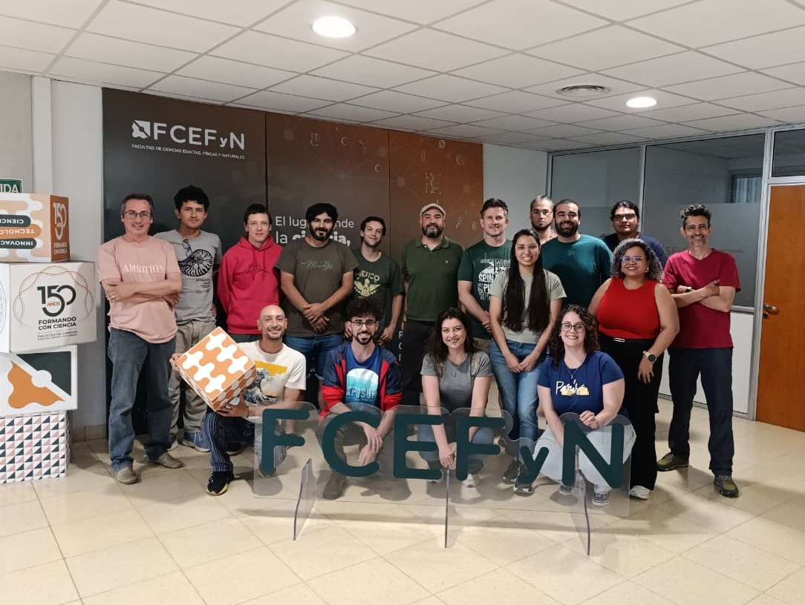

# Introducción a la Morfometría Geométrica en R 
## Aplicaciones en Métodos Comparativos Filogenéticos



Curso de posgrado para el doctorado en Cs. Biológicas de la Universidad Nacional de Córdoba.   

Este curso se dictará del 16 al 20 de noviembre de 2026 en forma **presencial** el aula 700-701 del Centro Nacional PLM (frente al estacionamiento de la FCEFyN, Ciudad Universitaria).    

El horario de cursado es de 9:00 a 18:00. Se debe asistir con su propia computadora personal y los softwares R y RStudio instalados en su última versión. Se sugiere descargar previamente los siguientes paquetes: *ape*, *dplyr*, *geiger*, *geomorph*, *ggplot2*, *ggrepel*, *Hmisc*, *magrittr*, *MASS*, *mclust*, *Morpho*, *mvMORPH*, *paleotree*, *pak*, *phytools*, *randomForest*, *RCurl*, *readxl*, *remotes*, *RRphylo*, *RRPP*, *StereoMorph*, *svglite*, *vegan*, *viridis*.

Para el práctico 9 necesitaremos el paquete phylo.fda. Para instalarlo ingresar en R:   

```
remotes::install_github("lschmitz/phylo.fda")
library(phylo.fda)
```

El paquete *morphospace* no se encuentra disponible en CRAN. Para instalarlo seguir estos pasos:

```
library(pak)
pak::pak("millacarmona/morphospace")
```


## Descarga del material práctico   
[link](https://github.com/curso-statsCBA/morfo_geom_R/archive/refs/heads/main.zip)

## Carpeta con material adicional y lecturas
[link](https://drive.google.com/drive/folders/1uY215aHw5vTLNsFwmmtinUE9_nnc09-7?usp=sharing)


## Cronograma simplificado.   

El curso consta de clases teóricas, ejercicios y laboratorio de análisis de datos.   

### Día 1.   
* Teórico: Contenido de la materia. Introducción a la morfometría geométrica.     
* Práctico 1: Técnicas para toma de datos en animales y plantas. Introducción al uso de R en Morfometría Geométrica. *Puesta a punto*  [LINK](https://drive.google.com/file/d/1zPAyvAwPt9FXmNk7AX3z4nFx1GUAqhuf/view?usp=sharing)  
* Práctico 2: Digitalización de landmarks y semilandmarks con *Stereomorph*. Importación de archivos .tps. Estructura de datos de coordenadas en R. Superimposición generalizada de Procrustes. Análisis de Componentes Pincipales. Missing data. [LINK](Práctico 2 - Digitalización/Digitalización_Stereomorph.html)[LINK presentación](https://drive.google.com/file/d/16vzy-W5or7Aeeqm7uP5tVeSCcwYoT7Tk/view?usp=sharing)    

### Día 2.   
* Teórico: Métodos multivariados en morfometría geométrica. Análisis de componentes principales (PCA) a partir de coordenadas de Procrustes. Análisis de variables Canónicas. Análisis Discriminante, Random Forest, Gaussian Admixture Analysis. Visualización de deformaciones. [LINK](https://docs.google.com/presentation/d/1LUFdUpMCK_BLXp5VICasMrzEYmV_C7big6Dzga7Socw/edit?usp=sharing)      
* Práctico 3: Métodos multivariados y técnicas de visualización. [LINK](Práctico 3 - Lapas/Lapas.html)   
* Teórico: Tipos de simetría y asimetría fluctuante. [LINK](https://drive.google.com/file/d/1kiDP_42qGjoYOYATeET_a08uyiwv7y2H/view?usp=sharing)      
* Práctico 4: Análisis de la Varianza de Procrustes y asimetría. [LINK](Práctico 4 - Simetría/practico_simetria.html)

### Día 3.  
* Teórico: Alometría. [LINK](https://drive.google.com/file/d/1JGm3olp1N_tvLl7PoVXvKv-CtPfg4fhj/view?usp=sharing)  
* Pŕactico 5: Alometría, tamaño del centroide, regresión de forma sobre tamaño, extracción de residuales alométricos y PCA corregido por tamaño. [LINK](Práctico 5 - Alometría/practico_alometria.html)   
* Teórico: Integración y modularidad. [LINK](https://docs.google.com/presentation/d/1FUTe6gR4gqBTTe53-tR9nad71vqUmUBhfUHyXTf1_4Q/edit?usp=sharing)     
* Práctico 6: Diseño de hipótesis de partición de módulos (anatómicos, funcionales y de desarrollo). Variación intra e interespecífica.      
Mínimos cuadrados parciales (PLS) entre subconjuntos de landmarks. [LINK](Práctico 6 - Modularidad/Modularidad.html)         
* Práctico 7: Taller de análisis de datos aportados por estudiantes.   

### Día 4.   
* Teórico: Métodos comparativos filogenéticos. [LINK](https://docs.google.com/presentation/d/1PGhbWXMSweNiu-SnaT7Iwbvh-GcDCfd6fvSbi72wt1U/edit?usp=sharing)     
* Práctico 8: Importación y manipulación básica de árboles filogenéticos. Señal filogenética. Filomorfoespacios y Análisis de Componentes Principales Filogenéticos. Regresiones lineales (mínimos cuadrados generalizados filogenéticos, MANOVA filogenético). Modularidad evolutiva. [LINK](Práctico 8 - Met Comp/Práctico_8_Introducción_Métodos_Comparativos.html)            
* Teórico: Fósiles en filogenias moleculares y paleoecología.      
* Práctico 9: Incorporación de fósiles en filogenias moleculares y estimación de paleoecología. [LINK](Práctico 9 - Estimación Paleoecología/Práctico-9---Estimación-Paleoecologia-y-Reconstrucción-de-Estados-Ancestrales.html)     

### Día 5.   
* Teórico: Macroevolución.      
* Práctico 10: Tempo: tasas de evolución fenotípica, Modo: disparidad morfológica, modelos macroevolutivos. [LINK_1](Práctico 10 - Macroevolución/Práctica_10_Macroevolución_Parte_1.html), [LINK_2](Práctico 10 - Macroevolución/Práctico_-10_Macroevolución_Parte_2.html), [LINK_3](Práctico 10 - Macroevolución/Práctico_Macroevolución_10_Parte_3.html)      
* Evaluación.     
